# Pandu's ZSA Voyager Keymap



> Generate/update the image: `./draw.sh` (requires `pipx install keymap-drawer`)

## Usage

```bash
./compile.sh   # build only
./flash.sh     # build + flash (press reset button when prompted)
./draw.sh      # regenerate keymap.svg
```

---

## Special Features

| Feature | Description |
|---------|-------------|
| **Hyper keys** | `Esc` and `'` on home row act as all-modifier (⌘⌃⌥⇧) when held |
| **Bottom row mods** | `^/Z` `⌥/X` `⌘/B` on left, `⌘/N` `⌥/.` `^//` on right — tap for letter, hold for modifier |
| **CMD_TAB** | L1 `'`: forward app cycle. Holds ⌘ open for 500ms so you can keep tapping |
| **CMD_SHIFT_TAB** | L1 `;`: backward app cycle. Same ⌘-hold behaviour |
| **Layer 4 corners** | `-` and `=` (top corners) double as L4 on hold |
| **Gaming combo** | `0` + `\` toggles Layer 2 (gaming) |

---

## Gaming Layer (L2)

Plain QWERTY with no tap/hold keys on the left half other than Esc/⌘, so every press registers instantly. Every key is defined explicitly, so nothing leaks through from the base layer. Toggle on and off with `0` + `\`.

| Key | Gaming behaviour |
|-----|------------------|
| Top-left | `⌥` |
| Home row left | Tap `Esc`, hold `⌘` (Esc is held 30ms so games register it) |
| Top-right | Plain `Esc`, for when Esc needs holding |
| Left thumbs | `Space` and `^` |
| Inner right thumb | Tap `Enter`, hold L3 |

## Gaming Fn Layer (L3)

Hold the inner right thumb while in L2.

| Keys | L3 behaviour |
|------|--------------|
| Left `W E R` / `S D F` / `X C V` | F7–F9 / F4–F6 / F1–F3 (numpad style, like L1) |
| Left `2 3 4` | F10–F12 |
| Right `8 9 0` | Previous, play/pause, next track |
| `Y` `U` `I` `O` `P` | Brightness down/up, volume down/up, mute |
| `H` `J` `K` `L` | Arrows |
| `N` `M` `,` `.` | Page Up, Page Down, Home, End |
| Outer right thumb | `Delete` |

---

## Generating SVG Layout Images

[keymap-drawer](https://github.com/caksoylar/keymap-drawer) can produce proper SVG diagrams from QMK source:

```bash
pipx install keymap-drawer
keymap-drawer parse --qmk-keymap-json <(qmk c2json -kb zsa/voyager -km vimager) > keymap.yaml
keymap-drawer draw keymap.yaml > keymap.svg
```
